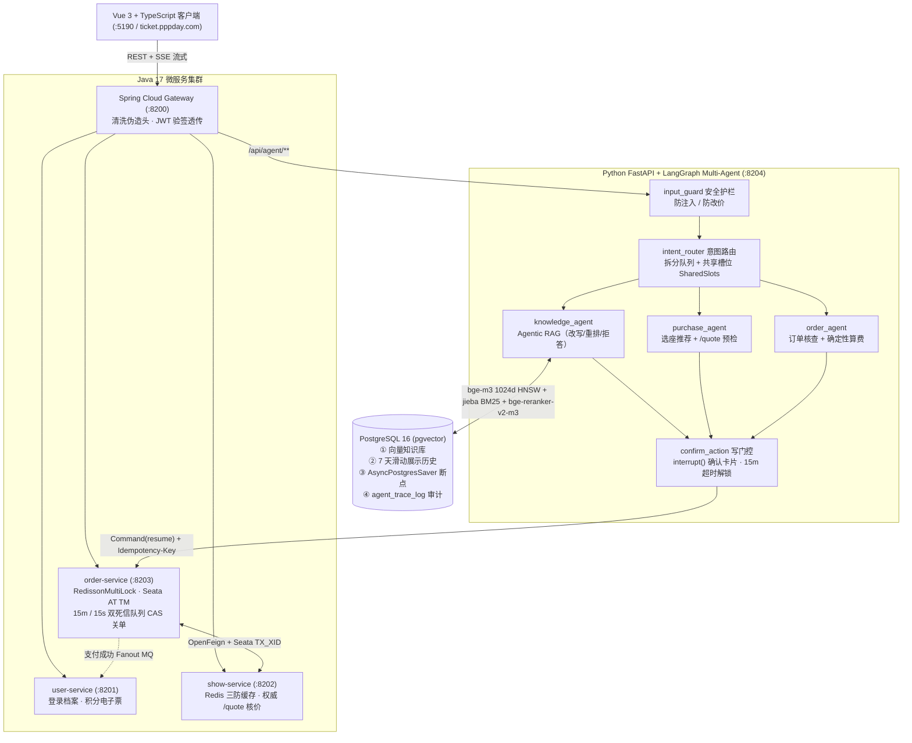

# PulseTicket · 在线选座购票微服务与 Multi-Agent 智能票务系统

[](https://openjdk.org/projects/jdk/17/)
[](https://spring.io/projects/spring-boot)
[](https://sca.aliyun.com/)
[](https://langchain-ai.github.io/langgraph/)
[](https://github.com/pgvector/pgvector)
[](https://vuejs.org/)

> **在线体验地址**：[`https://ticket.pppday.com`](https://ticket.pppday.com)
> - **普通购票会员一键体验**：`zhaolan` / `Ticket@2026`（在线选座大厅、Multi-Agent 智能选座下单、7 天历史会话恢复）
> - **架构运维管理员一键体验**：`admin` / `Admin@2026`（票房销量统计、三库实时看板、并发压测实验台、Agent 审计轨迹）

基于 **Spring Cloud Alibaba 2023.0.1.0（Nacos + Gateway + OpenFeign + Sentinel + Seata AT）+ Redisson + RabbitMQ + MySQL 8.0 + PostgreSQL 16（pgvector）+ FastAPI / LangGraph + Vue 3** 构建的异构协同票务系统，完整打通**高并发选座防超卖**与**受控 Multi-Agent 智能客服（Agent / Chat 双模式、SSE 真流式交互卡片、多档/靠边/精确排座推荐、锁座下单与已支付单阶梯退票）闭环**。

---

## 一、 系统架构与三层会话记忆设计



### 三层会话记忆与上下文工程（vs 模型污染防护）
1. **展示历史层（PostgreSQL 16 `agent_conversation` / `agent_message`）**：按登录 `X-User-Id` 严格隔离，支持侧边栏「今天 / 昨天 / 近 7 天」分组检索与删除；每次对话或确认后基于**最后活跃时间滑动顺延 7 天**，定时清理任务联动 `AsyncPostgresSaver.adelete_thread` 同步释放断点状态。
2. **模型上下文层（近 3 轮滑动窗口 + 结构化槽位）**：喂给路由与子图的上下文仅保留最近 **3 轮（6 条先序消息，助手长回复截断至 300 字符）**，配合 `SharedSlots` 透传演出/场次/预算/订单号，杜绝旧话题带来的 Context Rot 与无效 Token 膨胀。
3. **执行断点层（`AsyncPostgresSaver` + 15 分钟卡片过期解锁）**：高风险锁座与退改写操作强制 `interrupt()` 挂起并生成服务端报价卡片；超过 15 分钟未点击确认则在访问历史线程或继续提问时自动释放旧断点并标记 `EXPIRED`，防止过期报价误下单。

---

## 二、 核心工程与 AI 落地亮点

| 核心领域 | 工程落地实现 | 对应源码位置 |
| :--- | :--- | :--- |
| **1. 微服务分层与三棒身份透传** | 抽离 `ticket-common` 与 `ticket-feign-api`（DTO + Sentinel `FallbackFactory`）；Gateway `AuthGlobalFilter` 先 `remove` 客户端伪造请求头再注入校验后的 `X-User-Id` / `X-Username` / `X-Trace-Id`，下游经 `UserInfoInterceptor` (`ThreadLocal` 强制 `clear()`) 与 `FeignRelayAutoConfig` 全链路透传。 | `backend/ticket-common/`、`backend/ticket-feign-api/`、`backend/ticket-gateway/` |
| **2. Redis 缓存三防 + Redisson 三层防超卖** | 演出详情查询落地空值哨兵 `__NULL__` + Redisson `RLock` 互斥锁重建 + 随机抖动 TTL；`OrderFacade` 将锁包在 `@GlobalTransactional` 事务外，组合用户防重锁与按 `seatId` 升序排列的 `RedissonMultiLock`（消除死锁）+ DB 条件更新兜底，**30 线程压测 1 单成功、0 超卖**。 | `ShowCacheAndSeatService.java`、`OrderFacade.java`、`OrderTxService.java` |
| **3. Seata AT 回滚与双死信队列防队头阻塞** | 跨库锁座异常通过 Seata `undo_log` 自动回滚；RabbitMQ 订单超时关单拆分为 `15m` 标准队列与 `15s` 极速演示队列，消除单队列不同 TTL 的队头阻塞，触发 `WHERE status='UNPAID'` CAS 关单，唯一索引 `uk_order_biz` 保证积分消费幂等。 | `OrderMqConfigAndListener.java`、`UserOrderPaidConsumer.java` |
| **4. Agentic Hybrid RAG 与诚实降级** | 知识库按 `##` 二级标题 + `500` 字滑窗（`50` 字重叠）切分，经 `BAAI/bge-m3` 存入 **PostgreSQL 16（pgvector HNSW）**，与 `jieba BM25` 双路 RRF 融合并调用 `BAAI/bge-reranker-v2-m3` 精排；证据不足触发改写重试 1 次，仍不足诚实拒答且强制引用 `[POL-xxx]`；无 Embedding Key 时自动降级 `BM25-only` 并显式标注 `degraded=true`。 | `agent/app/rag/hybrid_rag.py`、`agent/app/graph/subgraphs/knowledge.py` |
| **5. 双模式流式交互、智能选座与阶梯退票** | 支持 **Agent 任务执行 / Chat 只读咨询**双模式切换、真 Token SSE 流式输出、内联折叠工具卡片与快捷选座/订单 Picker；选座引擎支持全票档比价（`priceTiers`）、低价/VIP 切换、靠边/中轴偏好及精确“第 X 排 Y 座”查库；售后子图与 Java `order-service` 打通已支付订单按 `[POL-REFUND-001]` 确定性阶梯退票与自动释放座位闭环。 | `agent/app/graph/subgraphs/purchase.py`、`agent/app/graph/subgraphs/order.py`、`OrderFacade.java` |
| **6. 44 条单元测试 + 54 条真实端到端基准评测** | 包含 **31 条 Python Agent 单元测试 + 13 条 Java Maven 单元测试**；另全真实调用 `pgvector-hnsw + BAAI/bge-m3 + bge-reranker-v2-m3` 跑完 54 条评测集：意图路由 **12/12 (100%)**、RAG Hit@1 与 Hit@3 **20/20 (100%)**、盲区拒答 **8/8 (100%)**、确定性退票算费 **6/6 (100%)**、注入与改价拦截 **8/8 (100%)**、未确认写 **0 次**。 | `agent/tests/`、`backend/*/src/test/`、`agent/eval/run_eval.py` |

---

## 三、 模块拓扑

```text
pulseticket/
├── backend/                          # Java 17 微服务 (Spring Boot 3.2.5 + Spring Cloud Alibaba 2023.0.1.0)
│   ├── ticket-common/                # 统一 Result / BizException / ThreadLocal 上下文 / JwtUtils
│   ├── ticket-feign-api/             # ShowSeatClient / DTO / Sentinel Fallback / Feign 拦截器
│   ├── ticket-gateway/               # API 网关 (:8200) -> JWT 鉴权、防伪造清洗、转发 /api/agent/**
│   ├── user-service/                 # 用户与积分 (:8201, MySQL: ticket_user)
│   ├── show-service/                 # 演出库存与权威核价 (:8202, MySQL: ticket_show)
│   └── order-service/                # 订单、锁座、Seata TM 与 DLX 关单 (:8203, MySQL: ticket_order)
├── agent/                            # Python Multi-Agent (:8204)
│   ├── app/graph/                    # 主 Graph 编排、安全护栏、3 个隔离业务子图
│   ├── app/rag/                      # pgvector HNSW + jieba BM25 + RRF + Cross-Encoder 混合检索
│   ├── app/storage/                  # PostgreSQL 16 7天展示历史与 15m 卡片失效管理
│   ├── app/observability/            # PostgreSQL agent_trace_log 全链路审计
│   └── tests/ & eval/                # 31 条 Python 单元测试 + 54 条真实 RAG/Agent 评测集
├── frontend/                         # Vue 3 + TypeScript + Tailwind CSS 选座大厅、历史对话抽屉与遥测看板
├── deploy/                           # Docker Compose (MySQL / Redis / RabbitMQ / Nacos / Seata / pgvector)
└── tools/                            # Nacos 配置初始化与 6 大微服务自动端到端验收脚本
```

---

## 四、 本地启动与自动化测试

```powershell
# 1. 启动中间件（含 pgvector/pgvector:pg16、MySQL、Redis、RabbitMQ、Nacos、Seata）
docker compose -f deploy/docker-compose.yml up -d

# 2. 复制环境变量模板并填入真实 Key（切勿提交 .env）
Copy-Item .env.example .env

# 3. 编译并运行 Java 微服务单元测试（13 条），再通过 Nacos 初始化配置启动
mvn -f backend/pom.xml test
mvn -f backend/pom.xml clean package -DskipTests
python tools/init_nacos_configs.py

# 4. 运行 Python Agent 全套 31 条单元测试与 54 条评测集
cd agent
python -X utf8 -m unittest discover -s tests -v
python -X utf8 eval/run_eval.py
```

---

## 五、 配套源码精读讲义
- [01_核心链路拆解_Redisson三层锁与Seata分布式事务.md](./docs/01_核心链路拆解_Redisson三层锁与Seata分布式事务.md)
- [02_核心链路拆解_RabbitMQ死信关单与缓存幂等.md](./docs/02_核心链路拆解_RabbitMQ死信关单与缓存幂等.md)
